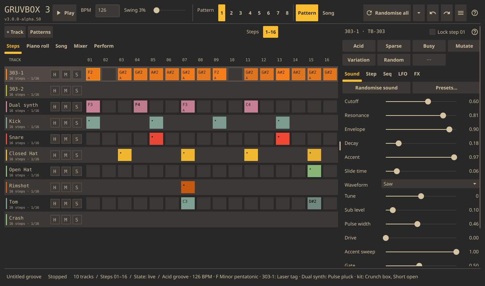
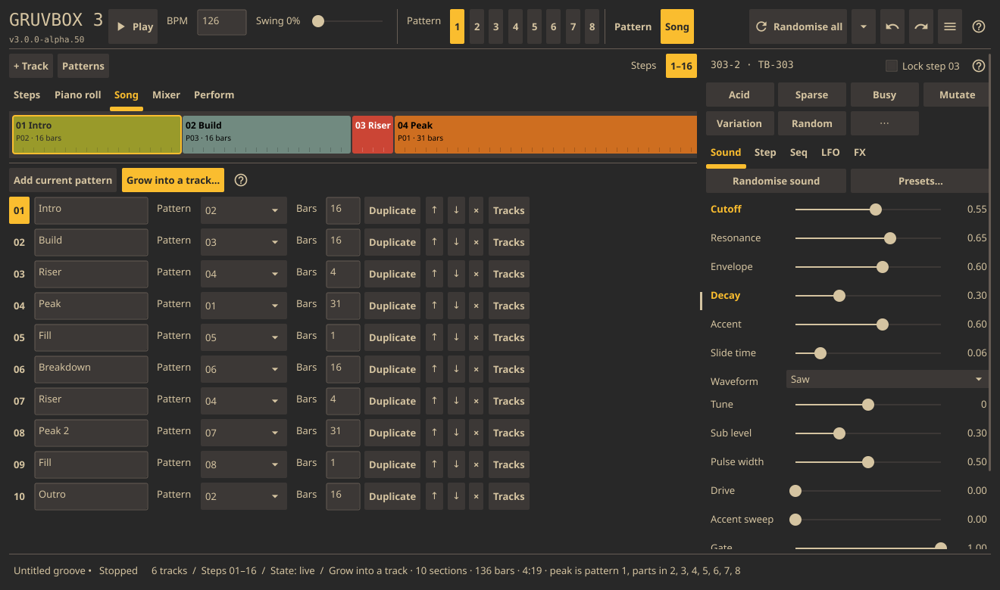
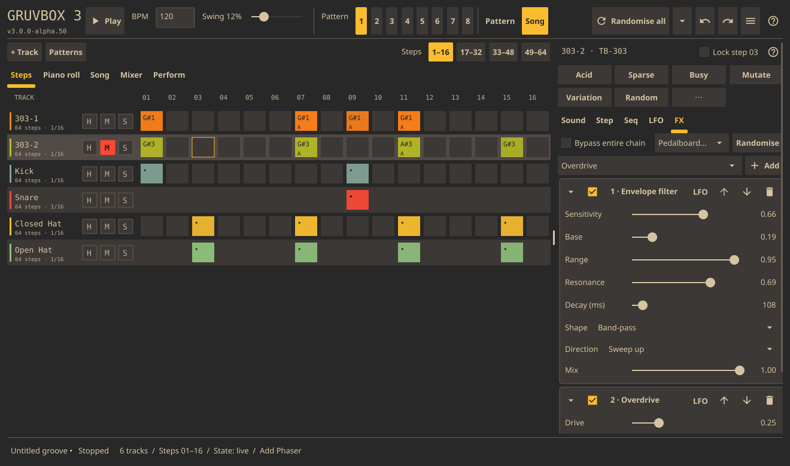
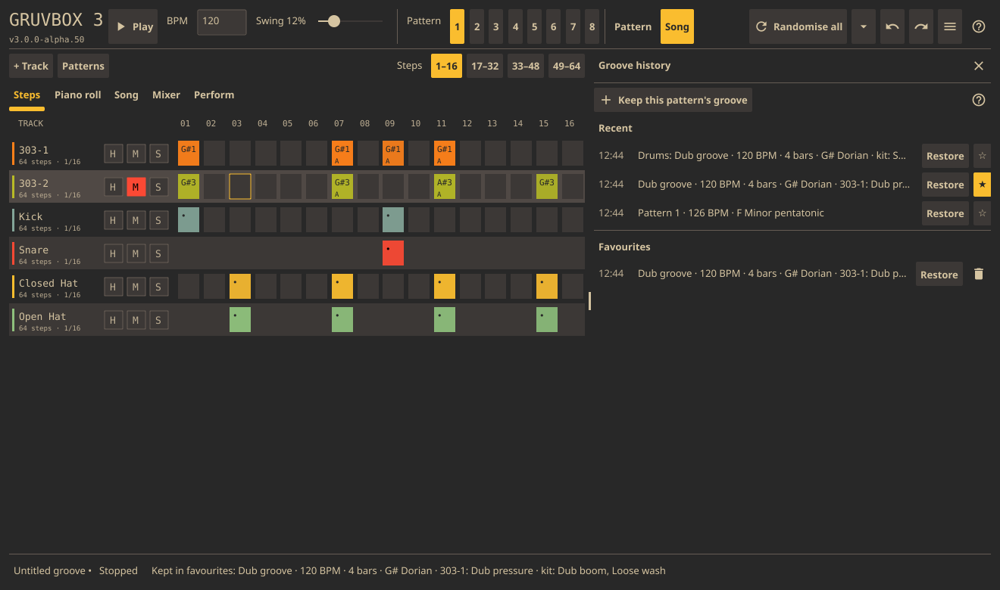
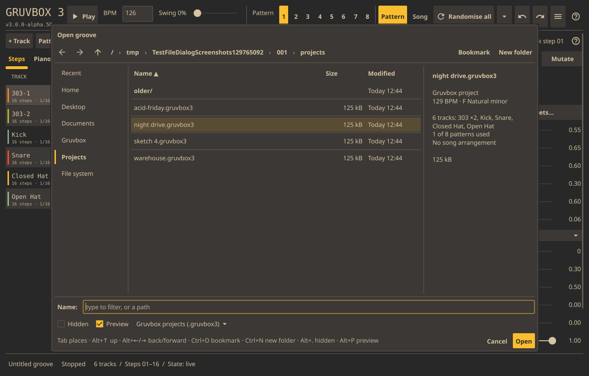

# Gruvbox - Desktop Groovebox

Version: 3.0.0-alpha.54

**A groovebox that starts with a good groove, and keeps it moving.**



Gruvbox is built around a real-time synth engine:
- two TB-303-style acid voices with a diode-ladder filter, accent and slide;
- an SH-101-inspired Dual synth;
- analog-modelled kick, snare, hats, clap, rimshot, toms and crash;
- a sampler.

Every track has its own effects chain, with twelve effect types (overdrive,
fuzz, envelope-filter wah, bit crusher, phaser, flanger, chorus, tape echo,
delay, reverb and more) and fifteen ready-made pedalboards. Each track has
two LFOs to sweep its sound controls, any control can be locked per step,
and the effects have LFOs of their own.

Press **Play** the moment it opens and you are already listening to something
worth keeping. Each launch writes a fresh groove in one of six styles (acid,
minimal, electro, dub, hypnotic or broken). It is in key, with a matching kit
and sounds, and its tracks are drawn from the whole pool. Hold the parts you
like and re-roll the rest. **Grow into a track…** turns the loop into a full
arrangement (intro, build, riser, peak, breakdown, outro) in a few seconds.
Switch on **Jam** and it keeps evolving while you listen: it rewrites a line
here, brings a part in there, swaps a sound, and builds and releases over
time. When it lands on something good, keep it. Groove history remembers
what you've heard and lets you star favourites. 64 pattern slots in eight
banks, song mode and WAV export take it from a jam to a finished track.

| | |
|---|---|
|  |  |
| **Grow into a track:** one loop becomes a whole song (ten sections and 4:19 here). | **Effects:** per-track pedal chains, each pedal with its own LFO. |
|  |  |
| **Groove history:** go back to anything you heard; star the keepers. | **Files:** a keyboard-driven Open/Save dialog with previews. |

It runs on Linux as a native desktop app. A legacy terminal interface is still
available with `--tui`. See [Getting it](#getting-it) for a pre-built binary.

If you enjoy it, you can [support Gruvbox on Ko-fi](https://ko-fi.com/subbaan). ♥

## Listen

These loops are straight out of Gruvbox: randomised patterns exported with
**Export WAV**, with no editing.

| Loop | Length |
|---|---|
| [▶ Sub Zero](docs/audio/sub-zero.mp3) | 0:08 |
| [▶ Phrygian Meltdown](docs/audio/phrygian-meltdown.mp3) (132 BPM, G Phrygian) | 0:08 |
| [▶ Velvet Undertow](docs/audio/velvet-undertow.mp3) (115 BPM, B minor, swung) | 0:08 |
| [▶ Abyssal Drift](docs/audio/abyssal-drift.mp3) | 0:08 |
| [▶ Easy Voltage](docs/audio/easy-voltage.mp3) | 0:04 |
| [▶ Ghost Signal](docs/audio/ghost-signal.mp3) | 0:07 |

## Latest additions

**Master bus (alpha.54):** playback and WAV export now go through a master
stage: +9 dB of make-up gain and a 1.4 ms look-ahead peak limiter with a
-1 dBFS ceiling, in place of the old hard clip at ±0.98. Generated grooves
used to peak around -10 dBFS (RMS about -27 dBFS); they now come out about
9 dB louder (RMS about -18 dBFS) without clipping, and the limiter usually
takes off 0–1.5 dB. Exported loops still start on the downbeat and loop
cleanly: export removes the look-ahead delay.

**Dual synth** is the new SH-101-inspired mono foundation: two oscillators
(saw/pulse/triangle/sine), a pulse sub and noise, a driven resonant 12/24 dB
low-pass filter, separate amp/filter ADSRs, glide and legato. Add it in **+ Track**,
press **Bassline**, then try **Sound → Presets…**. Six starting sounds cover bass,
plucks, detuned leads, a dub interval and a slow pad. Expand the Sound sections
for oscillator/envelope controls; time sliders use a logarithmic scale.
Long notes hold the gate, and slide flags glide between adjacent notes; choose
whether slides hold or retrigger the envelopes. Two bipolar LFOs sum around the
current knob/lock values. Randomise keeps tuning and attack/sustain shape while
exploring timbre. Live editing, step locks, sound presets and WAV export are wired
in. This is a new engine, not a hardware circuit emulation; chord editing and
polyphony are still to come.

Clap, Rimshot, Tom and Crash are available in **+ Track**, with live sound controls, dual LFOs, randomisation and parameter locks. Toms support pitched notes in the piano roll and a Bassline generator; Crash has a downbeat generator.

For a Tom bassline, add **Tom**, choose **Sound → Bass tone**, then enter notes in **Piano roll** or press **Bassline** at the top of the inspector. Bass tone tunes the root to C2 (65.41 Hz), removes the sweep and noise, and disables the LFOs. Adjust decay, sweep, attack and LFOs to taste. Notes transpose relative to C2; existing Tom patterns at C2 retain their sound. Root pitch, Tune and pitch locks still apply.

Sampler Sound controls include live gain, whole-sample peak normalization and fades following the trimmed region (including reverse). These settings are saved and undoable; the original WAV stays intact.

## Gruvbox 3 alpha

```bash
go build -o gruvbox
./gruvbox
```

The GUI alpha includes:

- Every launch, and **≡ → New ▸ Random groove**, starts a fresh groove in a
  random style: Acid, Minimal, Electro, Dub, Hypnotic or Broken. The style
  picks the tempo, swing, key and length (one, two or four bars; 303 lines
  develop across the bars and drums vary towards the end of a phrase), how the two 303s and the drums are written
  (drum patterns come from families such as four-on-the-floor, electro,
  broken, half-time, shuffle and rolling hats, with humanised velocity), the
  303 sounds, an occasional slow filter sweep and its effects (often a whole
  pedalboard, below). The second 303
  sits above the first and plays less, or sits out. Each groove also draws
  its own track layout from the whole pool: always a 303 lead, Kick and
  Closed Hat; a snare, a clap or both for the backbeat; a second 303 or a
  **Dual synth** (a counter line, stabs, a dub pad, or a detuned bass layer
  doubling the 303 an octave down, depending on the style); two to four of
  Open Hat, Rimshot, Tom and Crash, weighted by style (Minimal and Dub lean
  on rimshots, Electro on claps and tom calls); and one or two silent tracks
  with a sound ready, for you or Jam to
  bring in. Toms run down through the key; a crash hits once per loop, so only
  in two- and four-bar grooves. The status line names the style, tempo and
  key.
- **Randomise all** (top bar, **≡ → Randomise** or **Ctrl+R**) turns
  the selected pattern into a fresh groove, as if Gruvbox had just started: a
  new style, tempo, swing, key and length (up to four bars), and new sounds,
  effects and notes on every track. It keeps the project: its tracks, other patterns, mixer and song.
  Tracks the style has no part for get a random sound and a fitting pattern;
  samplers keep their sample and get a new pattern. One undo brings back
  what was there.
- **Hold** a track (the **H** chip by M/S, the **H** key or the track menu)
  and randomising leaves its pattern and sound alone. While anything is held
  the tempo and swing stay put, and a held 303 line keeps the key so new parts
  fit around it. The **▾** beside Randomise all also offers **Drums only**
  (**Ctrl+Shift+R**) and **303s only** (**Ctrl+Alt+R**).
- **Grow into a track** (**Song tab**, **Patterns** menu or **Ctrl+G**) turns
  the selected pattern into a whole arrangement. That pattern becomes the
  peak; the other seven pads of its bank get parts made from it (an intro of kick and
  hats, a filtered build, a four-bar riser with an opening filter and a snare
  roll, one-bar fills, a breakdown without kick and snare, and a second peak
  with a varied, hotter 303 line), and the song lays them out: Intro, Build,
  Riser, Peak, Fill, Breakdown, Riser, Peak 2, Fill, Outro. Choose **Short**
  (72 bars, about 2 minutes at 128 BPM) or **Full** (136 bars, about 4). It
  switches to song mode, so Play plays the track and Export WAV ▸ Song
  renders it. Sound changes in the sections are step locks, so later edits
  to a track's sound still reach every section. The card says what it will
  replace; one undo brings it all back. Each bank can hold its own grown
  song, so a peak in B3 fills only bank B.
- **Jam** (**Perform tab** or **J**) changes the groove every 4, 8 or 16
  bars while a pattern loops, by one of three amounts:
  - **Gentle**: one small move: a couple of steps of one part, a part
    dropped out or brought back, or a 303's cutoff, resonance, decay or
    envelope nudged.
  - **Evolving** (the default): one or two moves, which can also give a drum
    a new pattern (hats from eighths to a shuffle) or a new sound from the
    bank, write a new phrase into part of a 303 line (in key and register,
    keeping its opening), bring in a silent track (clap, rimshot, tom,
    crash…), and ride echo, reverb and chorus mixes. It builds for six
    changes (parts come in, filters open) and releases for six (parts drop
    out, it gets wetter); the panel shows which.
  - **Wild**: two or three moves at a time, bigger nudges, and sometimes a
    whole new 303 line or kick pattern.

  Changes land just before the bar, each is a normal edit (undo steps back
  through them), held tracks are left alone, and Jam waits in Song mode.
- **Groove history** (**▾ → Groove history…** or **Ctrl+H**) lists the last
  20 grooves Randomise made in this run, newest first, with the one Gruvbox
  started on. **Restore** puts one back in the selected pattern (tempo, key,
  notes and sounds; held tracks stay). Star (☆) a groove, or **Keep this
  pattern's groove**, to save it in **Favourites**, which persist between runs
  (`favourite-grooves.json` beside the sound library) and restore into any
  project: parts go to tracks of the same kind, in order.
- **≡ → New** opens the templates: Classic acid, Drum machine, Tom bass groove,
  Sampler kit and Empty project. Musical templates start with generated patterns;
  the sampler kit provides four named slots ready for your WAVs. Switching templates
  stops playback and prompts before discarding unsaved edits.
- Sample waveforms have inset trim markers so the End handle stays clear of the
  inspector scrollbar. Dragging retains accurate positions at every zoom level.

- Dynamic TB-303, kick, snare, open/closed hat, clap, rimshot, tom and crash tracks: add, duplicate, remove,
  reorder and rename. **+ Track** opens a dropdown; selecting an instrument adds
  it immediately. Right-click a track name to rename, duplicate, recolour, move or
  remove it; the **M** / **S** chips beside the name mute and solo. Each track has its own voice, mixer state and eight patterns.
- The 303 has a bank of 32 built-in sounds in **Sound → Presets…**, each a
  voice setting with its own pedals and sometimes an LFO: squelch and classic
  acid (Night squelch, Chirp, Laser tag, Glass acid, Resonant acid), driven
  (Fizz acid, Screamer, Molten, Grit pump), modulated (Phase squeal, Jet acid,
  Wobble, Tremble, PWM drift, Slow motion), wahs (Wah walker, Falling sigh,
  Swamp), bass and dub (Rubber worm, Dub pressure, Soft sub, Rounded sub,
  Cassette bass) and square and leads (Staccato stab, Hollow pipe, Needle lead,
  Ring bell, Dry square) and extended modes (Hollow band, Paper cut, Breath,
  Half and half). Random grooves often start their 303s on one that suits the
  style, and the status line names it. Their drums often start on fitting
  built-in drum sounds too (Dub boom and Big room in dub grooves, Electro zap
  in electro), listed after "kit:". Every drum kind has four to eight
  built-in sounds too (31 added in alpha.38), which Randomise sound uses as
  starting points.
- The 303 voice has character controls beyond the classic knobs, all off by
  default so older projects and presets sound as they did:
  - **Drive** saturates the oscillator into the filter and the filter's output,
    so the resonance grits up and screams.
  - **Accent sweep**: consecutive accents charge up and push the cutoff higher
    each time, while a plain note drains it (the classic acid "wow"). With
    sweep on, accented notes also use a short fixed filter decay.
  - **Gate** shortens notes for staccato lines; 1 lets every note ring.
  - **Pulse width** sets the square wave's duty cycle, from hollow to thin and
    nasal.
  - **Saw/square mix** blends in the other waveform (1 = an equal mix);
    **Waveform** picks the main one.
  - **Noise** adds white noise before the filter, for breathy or percussive
    tones.
  - **Filter mode**: the classic low-pass, or 12 dB band-pass or high-pass
    taken from the same ladder.
- Dynamic sampler tracks with mono/stereo WAV loading, waveform trim markers,
  pitched notes, reverse and one-shot/gate/loop playback. Samples are embedded
  in saved projects; loading, clearing and trim changes support undo/redo.
- Step sequencer and a three-octave piano roll (compact rows shaded like a keyboard, with a line at each octave) with octave navigation and draggable notes sharing the same note data. The roll centres itself and scrolls to the selected track's notes when you change track or pattern; Octave −/+ move it freely after that.
  Left-click toggles/enters notes; right-click selects a step for inspection.
  **Shift-click** selects multiple notes; drag a selected note to move the phrase.
  Select all, Clear selection, Duplicate, transpose ±1/±12 and Delete are below
  the roll. Arrow keys move/transpose a focused selection; Escape clears it.
  Phrase moves reject occupied destinations and preserve each note's settings.
- Drag a note's **right edge** to resize it, or use **Step → Length (steps)**.
  Length controls sampler **Gate** mode; One-shot/Loop and drum decay keep their
  existing behaviour. The 303 rings into its decay envelope unless its **Gate**
  control is below 1, when the note releases after Gate × its length (a note
  that slides into the next is held). A later onset retriggers the voice. Legacy notes remain one step;
  lengths save with projects and every gesture supports one-step undo.
- The inspector header holds the selected track's generators (Clear and the
  Euclidean, Locks and Phrase tools are under **⋯**), above the Sound, Step, Seq,
  LFO and FX tabs. The **Mixer** editor tab shows every track's level, pan, mute and
  solo side by side. Step editing includes velocity,
  probability, accent, slide, every-N-loop conditions and parameter locks.
- **Lock step** (or **K**) in the inspector header turns on lock mode. Moving any
  lockable Sound or FX control then writes a parameter lock for the selected step,
  and the controls show that step's values. Locked names are highlighted, controls
  that cannot be locked are dimmed, and clicking the grid selects steps instead of
  toggling them. Double-click a control's name to clear its lock, or (outside a lock)
  to reset it to its default. **Escape** leaves lock mode. The Step tab lists the
  step's locks with value sliders, **×** to remove one, **Add lock** for any lockable
  parameter and **Clear locks**. Steps with locks show **L** in the grid, even rests.
- **Randomise sound** in the Sound tab, or **R**: usually starts from one of
  the track's built-in sounds (an archetype) and varies it, so settings that
  belong together stay together; the status line and undo name it ("Randomise
  sound · Fizz acid"). Now and then every control is drawn independently
  instead. An empty FX chain also gets the archetype's pedals; an existing
  chain is left alone. Tuning stays put (and on the Dual synth, its interval
  and amp envelope shape), as do notes, sample trim and mixer settings. Undo
  recalls the previous sound.
- **Sound → Presets…** opens a movable, searchable sound library that follows
  the selected track. Try 89 built-in synth/drum sounds or **Save current…** to keep
  a discovery. Presets contain instrument controls, both LFOs, FX and their LFOs;
  sampler presets also embed the WAV, trim and processing settings.
  **Recall FX chain too** chooses whether to replace the chain and clear its
  FX locks. Notes, instrument locks and mixer settings stay; live recall supports
  undo/redo. Import/export portable `.gruvsound` files, or delete saved entries.
  Saved sounds live in `~/Documents/gruvbox/sounds` by default (beside the theme
  directory when using `--theme-dir`). The library reads metadata and decodes
  selected samples in the background; each preset file is limited to 32 MiB.
- Ordered stereo FX chains on every track: overdrive, fuzz, distortion,
  envelope filter, multimode filter, phaser, flanger, chorus, tape echo, delay,
  reverb, bit crusher and compressor. Add, reorder, remove and bypass individual units or the entire chain.
  FX controls save with projects, support undo, and can be locked per step.
  Each effect is a card: the header holds its on/off tick, name, **LFO** (lit
  while an LFO runs), move up/down and delete, and the arrow at the left folds
  the card to just its header.
- **FX → Pedalboard…** replaces the chain with a ready-made board of pedals
  whose settings vary each time within the board's idea: Squelch wah, Green
  drive, Fuzz acid, Phased acid, Jet stream, Dub tape, Pump and grind, Falling
  wah, Worn cassette and Glue for basslines; Crunch kit, Tape kit, Swirl, Small
  room and Crushed for drums. **Random board** picks one suited to the track.
- **FX → Randomise** explores moderate settings for the units in the chain; an
  empty chain gets a random pedalboard. Notes, samples, mixer state and chain
  bypass stay intact.
- The pedals, modelled loosely on stompboxes used after a 303:
  - **Overdrive**: mid-forward soft clipping with tone. **Fuzz**: two
    hard-driven stages into a scooped tone stack. Both keep the track at about
    its dry loudness; **Level** trims ±12 dB from there.
  - **Envelope filter**: an auto-wah; playing harder (accents) opens a resonant
    low- or band-pass further, sweeping up or down.
  - **Phaser** (4/6/8/12 stages) and **Flanger** (manual delay, feedback):
    their output is wet only, so a Mix around 0.5 gives the notches.
  - **Tape echo**: tempo-synced or free repeats that wobble (wow and flutter),
    saturate and darken; changing the time bends the pitch like real tape.
  - **Compressor**: threshold, ratio, attack, release and makeup.
- A card's **LFO** button opens a drawer with two LFOs per effect, including on
  samplers. Choose a continuous effect control, waveform, depth, free/tempo/step
  sync, phase and note retrigger. Modulation centres on the knob or current lock;
  two LFOs on one target add together. Settings save and support live undo.
- Chorus provides rate, depth, delay and feedback with offset stereo phases and
  smooth live changes. Bit crusher provides fractional bit depth and rate reduction.
  Both participate in effect randomisation once added to the chain.
- Delay supports free time or tempo divisions (including dotted notes), up to
  one bar at 40 BPM. Wet/dry changes ramp briefly; stop clears effect tails.
- Two LFOs per synth/drum track: target, six waveforms including sample & hold,
  depth, free Hz/tempo divisions/track-step sync, phase and note retrigger.
- The playing step is lit on every track, with a matching marker on its step
  number. Step colour fades with velocity, so quiet hits look quieter.
- Playback markers update at 60 Hz using retained canvas objects; the playhead
  follows consumed audio through an atomic step history. A 100 ms source buffer
  covers hardware periods without tying audio stability to animation refresh.
  DSP-sized short reads refill that reservoir without large render bursts.
- Generators, the Sound library and FX LFOs open in a **drawer** that takes over
  the inspector side of the window (widened while open) so the grid stays in view
  and usable. One drawer is open at a time; × or Esc closes it and brings the
  inspector back. Confirmations appear as a card over the window (Enter accepts,
  Esc cancels) and errors as a banner above the status line that fades after ten
  seconds or on ×. Conf, theme downloads, file pickers, recording and export keep
  movable native windows. Closing Conf cancels its theme preview; closing
  downloads cancels pending network work.
- Track lengths from 1 to 64 steps and resolutions from 1/4 to 1/64.
- Contextual generation, mutation and variation with undo/redo. Variation copies
  the current scene to the next slot and mutates the selected part.
  Each project has a key, chosen by its first melodic generation (or by the
  random groove) and saved with it. **Acid**, **Sparse** and **Busy** on a 303,
  and **Bassline** on the Dual synth or Tom, write motif-based phrases in that
  key using the Phrase engine, so separate parts agree; **Random** still scatters
  notes freely. On drums, **Random** picks a pattern family and varies it. The
  Phrase drawer opens in the project's key.
- **Phrase…** or **Patterns → Phrase generator…** composes 1-, 2- or 4-bar
  melodic phrases in 4/4 at sixteenth-note resolution (16/32/64 steps). Choose
  Hypnotic, Acid or Rolling, a root, register and scale: minor/major pentatonic,
  natural minor, Dorian, Phrygian or chromatic. Set notes per bar, pitch movement,
  bar variation and feel. Later bars reuse the first half of the motif and
  develop its ending; zero variation repeats the bar exactly. Movement zero
  stays on the root. Accents reinforce rhythmic focal points; incoming slides
  connect nearby different pitches and extend the preceding gate as needed.
  Available for 303, Dual synth, pitched Tom and Sampler; unsupported slide/gate
  features are omitted. Rhythm, Pitches and Feel rerolls have independent seeds.
  **Pitches only** preserves the current rhythm, gates, velocity, accents/slides
  and note conditions; **Feel only** preserves rhythm, pitches and conditions.
  Preview rows show notes, `>` accents and `~` incoming slides. Apply writes the
  displayed draft, resizes only this track and sets its resolution to 1/16, with
  one undo. Extending partial modes repeats existing notes; locks remain only
  at their original step positions. Drafts remain separate until Apply and close
  on pattern/project changes or track removal. Existing sound and FX stay.
- **⋯ → Euclidean…** in the inspector header or **Patterns → Euclidean rhythm…** creates
  evenly spaced pulses with a 1–64 step cycle, rotation, new-hit velocity and
  replace/layer modes. Preview stays separate until Apply; existing note settings
  and locks stay. Cycle length changes resize the selected track’s pattern with
  undo. The generator is bound to the track and pattern shown in its drawer.
- **Locks…** or **Patterns → Parameter-lock generator…** generates sweeps,
  ladders, sine waves, alternating pulses, accents, buildups, fades, shuffle,
  kick punch, random chaos and three humanisation strengths. Select an instrument
  group or FX unit, a parameter, Low/High in its actual units, and a step range.
  Active notes only is optional, so FX locks can shape tails on rests too.
  Random drafts stay fixed until Reroll; Apply commits the displayed values as one
  undo command. Other locks, notes, sound knobs and mixer state stay. Clear locks
  removes only the chosen parameter from eligible steps in the range. Switching
  patterns/projects, removing the track or removing targeted FX closes its drawer.
- Atomic save/load using the new versioned `.gruvbox3` format.
- **≡ → Appearance…**: live Base16 preview, Apply/Cancel, YAML imports and a
  searchable GitHub theme catalogue with background downloads and offline cache.

The GUI starts with an editable groove. Press Play or Space to hear it. Use the
generator buttons at the top of the inspector to generate a new part. Press R to explore a
new sound for the selected track. Arrow keys select steps
and tracks; Enter toggles a step, A toggles accent, L toggles slide and `,` / `.`
lower or raise its velocity. Ctrl+C / Ctrl+V copy and paste the selected step
(pasting moves on to the next step, so repeated pastes stamp a run);
Ctrl+Shift+C / Ctrl+Shift+V copy a track's whole pattern to another track.
Ctrl+Tab / Ctrl+Shift+Tab move between the editor tabs. The
**pattern pads** switch patterns. There are 64 slots, A1 to H8, in eight
banks of eight. The **A▾** button before the pads (or **Alt+1–8**) shows
bank A–H; its menu marks the banks holding patterns. The pads, or keys
**1–8**, pick a pattern in the bank shown. The current pattern is lit and
empty slots are dimmed. The view follows the pattern when it changes
elsewhere, such as song playback or history. Song sections, the patterns
menu and status lines name slots the same way. Projects saved in alpha.50
or earlier open with their 8 patterns in bank A. Blank slots take almost no
room in the file, but alpha.50 and earlier can't open projects saved now. **Steps** page buttons (or `[` / `]`) move between
16-step pages; pages with no notes are dimmed and `▸` marks the page that is
playing. Ctrl+Z undoes; Ctrl+Shift+Z or Ctrl+Y redoes. Ctrl+S saves straight to the project's file, asking for a path only
the first time; Ctrl+Shift+S or **Save as…** picks a new one. Sliders apply live
while you drag; release finishes one undo entry for the whole gesture. Text
fields apply on Enter or when you click away. The **?** buttons show help, and
the one in the top bar lists every keyboard shortcut.

**Opening and saving files.** Open, Save as, Load WAV, sound preset import and
export, recording saves, theme import and WAV export's **Browse…** all use one
file dialog (a Go port of the dialog in Plica):
- **Places** on the left: Recent (opening only), Home, Desktop, Documents,
  Gruvbox, the folder for what you are choosing, this project's folder, File
  system and your bookmarks.
- **Path bar** with back, forward and up; click a crumb to go there. In a
  narrow window the leading crumbs fold into "…".
- **List** of Name, Size and Modified, folders first. Click a header to sort,
  click it again to reverse. A double click opens.
- **Name field.** Opening, it filters the list as you type, and Enter opens the
  match. Saving, it holds the file name, and the extension is added if you
  leave it off. You can type a path (`~/beats/`, `../older`); a trailing `/`
  goes into that folder, and Backspace on an empty field goes up.
- **Preview** of the selected file: a project's tempo, key, tracks and song, a
  WAV's format and length, a sound preset's kind, or a theme's palette.
- **Keys:** Tab moves between the places and the list. Alt+↑ goes up and
  Alt+←/→ go back and forward. Ctrl+D bookmarks the folder, Ctrl+N makes a new
  folder, Alt+. shows hidden files and Alt+P toggles the preview.

Saving over an existing file asks first. Each dialog remembers its last
folder. Bookmarks and recent files are kept in `bookmarks.json` and
`recent-files.json` in the Gruvbox data folder. Recent files are listed
without touching the disk, so files on drives that are gone don't slow it down.

For samples: Add → Sampler, then Sound → Load WAV. Drag a waveform marker or
use the Start/End sliders to trim. C2 plays at the original pitch; higher/lower
notes transpose the sample. Pitch supports per-step locks. WAV loading accepts
PCM 8/16/24/32-bit or float32, mono/stereo at 8–192 kHz, up to 16 MiB per file.
Projects including embedded samples are limited to 64 MiB. Pitch changes also
change duration; time-stretching is not implemented.

**Sampler → Sound → Record…** opens a movable recording window. Choose the
default system output, default input or a discovered device; select stereo/mono
and a captured-duration limit of 5–90 seconds. Record shows duration, peak level
and clipping; Stop prepares a waveform preview. Drag its markers, audition and
press **Use take** to load the trimmed region with one undo. The original WAV
stays embedded in the project/preset; existing notes, FX and mixer settings stay.
**Save WAV…** saves the full original take independently, with atomic replacement.
Closing the recording window cancels capture; replacing the project or removing
its target track also cancels. Recording runs independently of playback and works
in `--no-audio` editing mode, although audition needs audio output.
Linux capture uses `parec`; optional device discovery uses `pactl`. Both are
PulseAudio tools and can use PipeWire's PulseAudio compatibility service. The
default output source captures all audio on that output, including Gruvbox.

Use **Audition** in sampler Sound to preview the trimmed sample as a one-shot,
independently of transport (before track FX and mute/solo). **Stop preview** stops
it. **Zoom +/−**, pan arrows, **Fit trim** and **Full** help place trim markers;
zoom stays in place while editing.

Pattern choices during playback launch on the next 4/4 bar boundary. The status line
shows the playing pattern and pending choice. The **Song** tab opens with a
timeline: one block per section, as wide as its bars, lit while it plays with a
marker on the current bar. Click a block (or a row number) to select that
section's row. Below it, add named sections,
choose their patterns and bar counts, and duplicate/reorder/remove them. Choose
**Song** (beside the pattern pads) before Play to begin at section 01, or during
playback to start on the next bar; **Pattern** returns to looping the selected pattern. The arrangement loops and is saved with the project. Selecting a
different pattern returns to manual playback at the next bar. Song edits are undoable.
Use a section’s **Tracks** button for mute overrides, or **Capture mixer mutes**
to keep a breakdown/drop configuration. **Live** removes that track's override
and uses its pattern's stored mute, or the live mixer if no state is stored.
**Use live mutes** clears every override. Track solo still applies.

**Ctrl+Shift+P** or **Patterns → Store state** captures all tracks' mute/solo, level/pan, instrument
controls, both instrument LFOs, ordered FX chains (including bypass, settings and
their LFOs), sampler audio, trim, playback and processing settings. Notes, locks,
lengths and resolution already belong to their patterns and remain editable.
Store again explicitly to replace a snapshot. The status line shows **live**,
**stored**, or **stored · edited**; live tweaks do not overwrite the snapshot.
Selecting a stored pattern recalls its controls; while playing, its sound and
mutes launch with its notes at the next bar. **Patterns → Recall stored state**
restores the current pattern immediately; **Clear stored state** removes its
snapshot while keeping the current controls. These actions support undo/redo.
Save the project normally with **Ctrl+S** to persist everything to disk.

Patterns without stored controls use the current live controls, including older
projects. Copies and variations carry independent stored snapshots; empty-slot
discovery protects slots containing a snapshot even when their notes are empty.
Stored FX chains retain their effect identities and locks when the live chain
changes. Recalling a different chain clears locks whose FX belong to neither
the live chain nor that pattern's stored chain. Sampler snapshots embed their
original WAVs; the existing 64 MiB project limit applies. Tempo and swing remain
project controls; names, colours and track identity remain shared.
Song playback and song WAV export recall stored controls for each section's
pattern, with section mute overrides applied afterwards. The editor follows song
launches without adding undo entries or making an unchanged saved song dirty.

**Patterns** provides whole-groove duplication, a variation of the selected
track within a copied groove, and explicit copies to a replacement slot. Automatic
duplication uses an empty slot; Ctrl+D duplicates the whole groove.

**Perform** queues a drum fill, selected-track variation or whole-groove variation
for the next 4/4 bar; **F** queues a drum fill while playing. Each plays for one bar and returns automatically; another
cue replaces the queued one, and Cancel clears it. Song sections keep advancing
underneath. Live sound controls remain available and effects keep their tails.
Cues restart pattern cycles and use a snapshot of the sounding scene. Original
patterns stay intact. **Keep last take → empty pattern** saves the launched take
into an unused slot with undo, including after Stop. Manual pattern selection
cancels a pending cue; Stop clears pending/playing cues.

**≡ → Export WAV** writes the selected pattern or full song to a stereo 16-bit WAV at
44.1 kHz, with an optional 0–10 second effect tail. Export runs independently of
live playback and editing. Closing the export window cancels; failed or cancelled
exports preserve an existing destination.

This is an early alpha. Destructive sample editing, broader performance macros,
additional FX/modulation, chord editing/polyphony and plugin hosting are upcoming
milestones. Gruvbox 2 import is out of scope.
The GUI rejects legacy projects rather than silently losing their data. The TUI
continues to use the legacy project format and feature set described below.

Use `./gruvbox --no-audio` to edit without opening an audio device. Linux builds
require a C compiler and OpenGL/X11 development libraries for Fyne.

Validation:

```bash
go test -tags ci ./...
go test -race ./capture ./groove ./synth ./effects ./theme
xvfb-run -a -s '-screen 0 1440x1000x24' bash scripts/gui-smoke.sh
xvfb-run -a -s '-screen 0 1440x1000x24' bash scripts/recording-smoke.sh
xvfb-run -a -s '-screen 0 1440x1000x24' bash scripts/generators-smoke.sh
```

The smoke scripts require Xvfb, xdotool and ImageMagick and write captures to
`artifacts/`. The GUI audio renderer receives immutable snapshots at block
boundaries; existing voice state is owned by the audio thread. The render test
checks zero callback allocations and timing without an audio device.
The recording smoke check uses a synthetic signal and requires Python 3; it
does not record physical inputs or system audio.

## Legacy TUI status

**Phase 1: Audio Foundation - ✅ COMPLETE**
- ✅ Real-time audio engine with oto v3 integration
- ✅ Multi-channel mixer with pan, level, solo, mute
- ✅ Lock-free ring buffer for UI → Audio thread communication
- ✅ Pre-allocated buffers (no GC in audio callback)

**Phase 2: TB-303 Core - ✅ COMPLETE**
- ✅ Anti-aliased oscillators (polyBLEP) - sawtooth & square waves
- ✅ Decay envelope generators (exponential curves)
- ✅ **Diode ladder filter (24dB/oct)** - THE critical component
  - Topology-preserving transform (TPT) implementation
  - Mismatched capacitor values (stage 2 = 0.5×)
  - Non-linear saturation for transistor characteristic
- ✅ Complete TB-303 voice with:
  - Filter envelope modulation
  - Accent (boosts envelope depth and volume)
  - Slide/portamento (exponential pitch glide)
  - Tuning control
  - LFO with 6 modulation targets: Cutoff, Resonance, Pitch, Env Mod, Pulse Width, Volume
- ✅ Dual TB-303 instances for bass + lead

**Phase 3: Step Sequencer - ✅ COMPLETE**
- ✅ Step data structure with note, velocity, accent, slide, probability
- ✅ Pattern storage (16/32 steps, extendable to 64)
- ✅ Sample-accurate clock with BPM control (40-300 BPM)
- ✅ Swing support (0-100%)
- ✅ Track management for multiple instruments
- ✅ Main sequencer engine with real-time playback
- ✅ Integration with TB-303 triggering

**Phase 4: Drum Synthesis - ✅ COMPLETE**
- ✅ Analog-modeled kick drum (pitch envelope, sine wave, attack click, drive)
- ✅ Analog-modeled snare drum (dual oscillators, filtered noise, snap control)
- ✅ Analog-modeled hi-hat (6 non-harmonic oscillators, closed/open variants)
- ✅ Drum voice interface
- ✅ Integration with sequencer and audio engine
- ✅ Complete drum machine with kick, snare, closed/open hi-hats

**Phase 5: Effects Processing - ✅ COMPLETE**
- ✅ Effect interface and base effect class
- ✅ Distortion/overdrive with drive, tone control, and soft clipping
- ✅ Delay with feedback, tone filter in feedback path
- ✅ Reverb (Freeverb algorithm with 8 combs + 4 allpass filters)
- ✅ Effect chain manager for serial processing
- ✅ Per-channel effect chains integrated with mixer
- ✅ Dry/wet mix control for all effects

**Phase 6: Terminal UI - ✅ COMPLETE**
- ✅ Bubble Tea framework integration
- ✅ Step grid display with Gruvbox styling
- ✅ Transport controls (play/stop, BPM)
- ✅ Keyboard navigation (arrows, Enter, Space)
- ✅ Step editing (toggle, accent, slide)
- ✅ TB-303 parameter panels
- ✅ Drum parameter panels
- ✅ Effects control panels
- ✅ Mixer view with level meters

**Audio Configuration:**
- Sample rate: 44100 Hz
- Buffer size: 256 samples (~5.8ms latency)
- Format: Stereo 16-bit signed integer
- Channels: 8 mixer channels

## Getting it

Pre-built Linux x86-64 binaries are attached to the
[releases](https://github.com/subbaan/gruvbox/releases). Download
`gruvbox-linux-x86_64`, make it executable (`chmod +x`) and run it.

## Support

If Gruvbox gives you a groove worth keeping, you can buy me a coffee at
[ko-fi.com/subbaan](https://ko-fi.com/subbaan). The link is also in the app,
under **≡ ▸ Support on Ko-fi…** and **≡ ▸ About Gruvbox…**.

## Building

Needs Go 1.24 or newer and a C compiler. Fyne and the audio backend need the
OpenGL, X11 and ALSA development files:
- Arch: `mesa libx11 libxcursor libxrandr libxinerama libxi libxxf86vm alsa-lib`
- Debian or Ubuntu: `libgl1-mesa-dev xorg-dev libasound2-dev`

```bash
git clone https://github.com/subbaan/gruvbox.git
cd gruvbox
go build -o gruvbox
./gruvbox --version
go test ./...
```

The binary is built in the project folder. Projects, samples, themes and
settings are kept in `~/Documents/gruvbox`.

## Running

### Themes (foundation for Gruvbox 3)

The desktop and terminal UIs use the shared Base16 theme system. Warm Dark is the
default; Gruvbox Dark is also bundled. Theme commands exit before starting audio.

```bash
./gruvbox --theme-list
./gruvbox --theme gruvbox-dark
./gruvbox --theme-import /path/to/my-theme.yaml
./gruvbox --theme-download gruvbox-dark-hard
./gruvbox --theme github-gruvbox-dark-hard
./gruvbox
```

Downloads use the Base16 collection at
[Tinted Theming on GitHub](https://github.com/tinted-theming/schemes), recording
the source and file revision. Imports accept modern nested and legacy flat YAML
palettes. All sixteen colours must be valid before an installed copy is replaced.
Imports have `local-` IDs; downloads have `github-` IDs and do not overwrite imports.

Themes and the saved selection live in `~/Documents/gruvbox/themes/`.
Use `--theme-dir /path/to/themes` on every command and launch to choose another
library. Installed and bundled themes work offline. Select `warm-dark` to reset;
if the saved selection cannot load, startup falls back to Warm Dark.

The desktop Conf panel provides the same library plus live preview, imports,
catalogue search and background downloads.

```bash
./gruvbox
```

The application launches with an interactive terminal UI featuring:

**Global Controls:**
- **Enter**: Play/Stop sequencer
- **Tab**: Switch between views (Sequencer/Synth/Drums/Effects/Mixer/Song)
- **Ctrl+1-6**: Quick switch to specific view
- **+/-**: Adjust BPM
- **Ctrl+S**: Save project
- **Ctrl+L**: Load project
- **Ctrl+Q**: Quit

**Sequencer View:**
- **Arrow keys**: Navigate step grid
- **Space**: Toggle step on/off
- **A**: Toggle accent on current step
- **S**: Toggle slide on current step
- **[ / ]**: Switch between patterns (16 patterns available per instrument)
- **{ / }**: Change pattern length (16/32/64 steps) - cycles through available lengths
- **Shift+C**: Copy current pattern to next slot
- **Shift+P**: Save current sound settings to pattern (patterns remember sounds)
- **N**: Toggle note entry mode (TB-303 tracks only)
  - In note entry mode:
    - **Z-M keys**: Play notes (keyboard as piano)
    - **Q/W**: Change octave down/up
    - Auto-advances to next step after note entry
- **G**: Generate dense acid bassline pattern (TB-303 tracks only)
- **Shift+G**: Generate sparse acid bassline pattern (TB-303 tracks only)
- **Shift+R**: Randomize sound parameters for selected track
- **Shift+H**: Cycle through hi-hat patterns (8ths, 16ths, swing, offbeat, sparse)
- **Shift+F**: Generate drum fill pattern (cycles through 4 variations)
- **Shift+B**: Generate buildup pattern (cycles through 3 variations)
- **Shift+K**: Generate 4-on-the-floor kick pattern
- **x**: Clear all steps on current track
- **m**: Toggle mute on selected track
- **o**: Toggle solo on selected track

**Synth View (TB-303):**
- **Left/Right**: Switch between TB-303 #1 and #2
- **Up/Down**: Select parameter
- **</>**: Adjust parameter value
- **W**: Toggle waveform (Saw/Square)
- **R**: Randomize synth sound parameters

**Drums View:**
- **1-4**: Select drum (Kick/Snare/HH Closed/HH Open)
- **Up/Down**: Select parameter
- **</>**: Adjust parameter value
- **R**: Randomize drum sound parameters

**Effects View:**
- **1-6**: Select channel (TB-303 #1/TB-303 #2/Kick/Snare/HH Closed/HH Open)
- **Left/Right**: Select effect (Distortion/Delay/Reverb)
- **Up/Down**: Navigate parameters within effect (Enable, Param1, Param2, Mix)
- **</>**: Adjust parameter value
- **E**: Toggle effect on/off

**Effects Parameters:**
- Distortion: Enable, Drive, Tone, Mix
- Delay: Enable, Time, Feedback, Mix
- Reverb: Enable, Room Size, Damping, Mix

**Mixer View:**
- **1-6**: Select channel (TB-303 #1/TB-303 #2/Kick/Snare/HH Closed/HH Open)
- **Up/Down**: Navigate parameters (Level/Pan/Mute/Solo)
- **</>**: Adjust level/pan
- **m**: Toggle mute on selected channel (quantized to pattern end)
- **M** (Shift+m): Toggle mute (quantized to 4-bar phrase)
- **s**: Toggle solo on selected channel (quantized to pattern end)
- **S** (Shift+s): Toggle solo (quantized to 4-bar phrase)

**Pre-configured Sound:**
- **TB-303 #1**: Saw wave bass with distortion + delay
- **TB-303 #2**: Square wave lead with delay + reverb
- **Drums**: Analog-modeled kick, snare, and hi-hats
- **Effects**: Per-channel distortion, delay, and reverb
- **Tempo**: 128 BPM (adjustable)

**Step Symbols:**
- `░` - Inactive step
- `█` - Active step
- `▪` - Accent
- `~` - Slide (TB-303 only)
- `▲` - Both accent and slide

**Visual Indicators:**
- Yellow background: Current cursor position (highly visible, easy to track)
- Red background: Currently playing step
- Green/blue text: Active steps and selected tracks
- Cursor wraps around at edges for quick navigation

The app starts with a simple demo pattern - edit it to create your own grooves!

## Creative Features

**Note Entry Mode (TB-303 tracks):**
- Press **N** to toggle note entry mode on TB-303 tracks
- Use your keyboard as a piano (Z-M keys for notes, S/D/G/H/J for sharps)
- Adjust octave with Q/W keys (octave 2-6)
- Cursor auto-advances to next step after entering a note
- Perfect for creating custom melodies and basslines

**Algorithmic Pattern Generation (TB-303 tracks):**
- **G** - Generate dense acid bassline (~70% note density)
  - Uses minor pentatonic scale
  - Mix of stepwise motion (40%), jumps (30%), and repeated notes (30%)
  - Automatic accent placement (25% of notes)
  - Automatic slide placement (15% of notes)
  - Beat 1 always emphasized with accent
- **Shift+G** - Generate sparse acid bassline (~40% note density)
  - More space and rests
  - Higher accent probability (35%)
  - Great for minimal techno patterns

**Sound Randomization:**
- **Shift+R** (Sequencer view) - Randomize selected track's sound parameters
- **R** (Synth view) - Randomize TB-303 filter, envelope, waveform, and LFO settings
- **R** (Drum view) - Randomize selected drum's tuning, decay, tone, and drive
- All randomization uses musical ranges for playable results
- Great for happy accidents and sound design inspiration

**Variable Pattern Lengths:**
- **{/}** keys - Cycle through pattern lengths (16/32/64 steps)
- Each track can have different pattern lengths for polyrhythmic patterns
- Cursor auto-scrolls when navigating beyond visible 16-step window
- Pattern length indicator shows current length and visible range
- Longer patterns enable:
  - Extended sequences and evolving patterns
  - Polyrhythmic relationships between instruments
  - EDM-style buildups and breakdowns
  - More complex phrase structures

**Pattern Management:**
- **16 patterns per instrument** - Each instrument can store 16 unique patterns (0-15)
- **[/]** keys - Navigate between patterns in sequencer view
- **Shift+C** - Copy current pattern to next slot for variations
- **Shift+P** - Save current sound settings to pattern
- **Pattern sound memory** - Each pattern remembers its sound settings
  - TB-303 patterns store filter, envelope, waveform, LFO settings
  - Drum patterns store tuning, decay, tone, and drive settings
  - Sound automatically loads when switching patterns
  - Add sonic variety to song arrangements
- Pattern switching updates all tracks simultaneously
- **Song Mode integration** - Reference different patterns in your song arrangement
- Create pattern libraries for verses, choruses, breaks, and fills

**Project Management:**
- **Ctrl+S** - Save complete project to disk
- **Ctrl+L** - Load project from disk
- Projects saved as `.gruvbox` JSON files in `projects/` directory
- **Complete state preservation**:
  - All 16 patterns for all 6 instruments (96 patterns total!)
  - Song arrangement and loop settings
  - All synth parameters (TB-303 #1 & #2)
  - All drum parameters (Kick, Snare, Hi-hats)
  - All effects settings (per-channel distortion, delay, reverb)
  - Mixer settings (levels, pan, mute, solo)
  - Global settings (BPM, pattern selection)
- Human-readable JSON format for easy backup and version control
- Share projects with collaborators
- Build a library of grooves and arrangements

**Quantized Mixer Controls:**
- Mute/Solo changes are quantized to musical boundaries for smooth transitions
- **m/s** (lowercase) - Changes occur at end of pattern (16 steps)
- **M/S** (Shift+m/s) - Changes occur at end of 4-bar phrase (64 steps)
- Perfect for live performance and arrangement without clicks or pops
- Maintains musical timing and groove

## Performance Features

**Cursor Navigation:**
- Wrap-around navigation at edges (no dead ends)
- Highly visible yellow cursor highlight
- Smooth navigation across all 6 tracks and 16 steps

**Effects Control:**
- All effects have Mix parameter for precise wet/dry balance
- Individual enable/disable per effect per channel
- Real-time parameter adjustment without audio glitches

## Project Structure

```
gruvbox/
├── VERSION                  # Version file (0.1.0)
├── main.go                  # Entry point with TB-303 demo
├── go.mod                   # Go module definition
├── audio/                   # Audio engine
│   ├── constants.go         # Audio configuration constants
│   ├── engine.go            # Real-time audio engine
│   └── mixer.go             # Multi-channel mixer
├── synth/                   # Synthesizers
│   ├── oscillator.go        # Anti-aliased oscillators (polyBLEP)
│   ├── envelope.go          # Envelope generators (ADSR, decay)
│   ├── tb303.go             # Complete TB-303 voice
│   └── tb303_filter.go      # TB-303 filter with envelope
├── dsp/                     # DSP building blocks
│   └── ladder_filter.go     # Diode ladder filter (24dB/oct)
├── sequencer/               # Step sequencer
│   ├── step.go              # Step data structure
│   ├── pattern.go           # Pattern storage and manipulation
│   ├── clock.go             # Sample-accurate timing
│   ├── track.go             # Track management
│   └── sequencer.go         # Main sequencer engine
└── util/                    # Utilities
    ├── ring_buffer.go       # Lock-free parameter updates
    └── math.go              # DSP math utilities
```

## Next Steps

**Phase 6: Terminal UI** ✅ COMPLETE
- [x] Bubble Tea framework integration
- [x] Step grid display with navigation
- [x] Transport controls (play/stop/BPM)
- [x] TB-303 parameter panels
- [x] Drum parameter panels
- [x] Effects parameter panels
- [x] Mixer view with level meters
- [x] Note entry mode with keyboard-as-piano
- [x] Algorithmic pattern generation (dense & sparse)
- [x] Sound randomization for all instruments
- [x] Quantized mute/solo for smooth transitions
- [x] Cursor wrap-around and enhanced visibility

**Phase 7: Song Mode & Project Management** (Next Priority)
- [ ] Song mode view for pattern arrangement
- [ ] Pattern chaining and sequencing
- [ ] Pattern copy/paste/duplicate
- [ ] JSON-based project save/load
- [ ] Pattern library and recall
- [ ] Preset management for synths and drums

**Phase 8: Advanced Features** (Future)
- [ ] MIDI input/output support
- [ ] Audio file export (WAV rendering)
- [ ] Additional synthesizer voices
- [ ] More drum synthesis options
- [ ] Additional effect types (chorus, flanger, phaser)
- [ ] Per-step parameter locks (p-locks)

## Technical Details

### Real-Time Audio Thread Safety

The audio engine follows strict real-time audio programming principles:

**Never in audio callback:**
- Dynamic memory allocation (malloc/new)
- Mutex locks
- I/O operations (printf, file I/O)
- Blocking channel operations

**Always in audio callback:**
- Pre-allocated buffers
- Atomic operations
- Lock-free data structures
- Fast math operations

### Audio Engine Architecture

The `Engine.Read()` method is the core audio callback:

1. Process parameter updates from UI (lock-free ring buffer)
2. Clear mixer channel buffers
3. Render audio sources (synths, drums) into channels
4. Mix all channels to stereo output
5. Convert float32 → int16 → bytes
6. Return buffer to oto

### Mixer Features

- 8 independent channels with pre-allocated buffers
- Per-channel level (0-100%) and pan (-1 to +1)
- Solo and mute support
- Constant-power panning
- Master bus: +9 dB make-up gain into a look-ahead peak limiter (-1 dBFS
  ceiling), shared by playback and export (`groove/master.go`)
- Peak level metering

## Dependencies

- `fyne.io/fyne/v2` - desktop GUI
- `github.com/ebitengine/oto/v3` - cross-platform low-latency audio
- `github.com/jezek/xgb` - X11 hints that keep utility windows above the main window
- `github.com/charmbracelet/bubbletea` - legacy terminal UI
- `github.com/charmbracelet/lipgloss` - terminal UI styling

## License

MIT. See [LICENSE](LICENSE).

## Development

Design notes and session logs live beside the code:
- `GRUVBOX3_PRODUCT_DESIGN.md`: the Gruvbox 3 product design.
- `UI_REDESIGN_PLAN.md`: the desktop GUI rework, including the file dialog.
- `SOUND_VARIETY_PLAN.md`: grooves, sounds, the 303 voice and effects.
- `TRACK_BUILDER_PLAN.md`: Hold, Grow, Jam and groove history.
- `CLAUDE.md`: architecture and real-time audio rules.

`scripts/*-smoke.sh` drive the real app for screenshot checks. They write
into `artifacts/`, which is not checked in.
