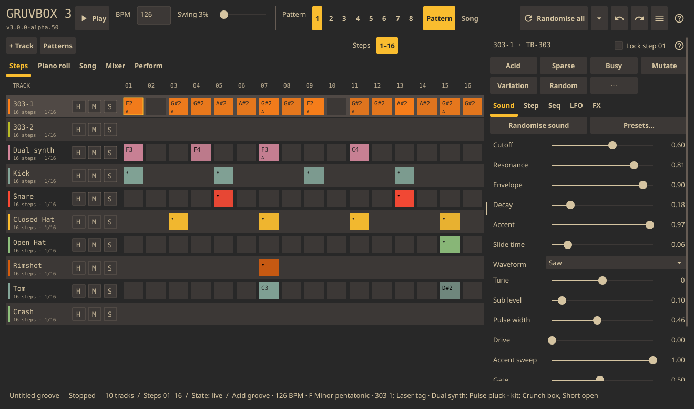
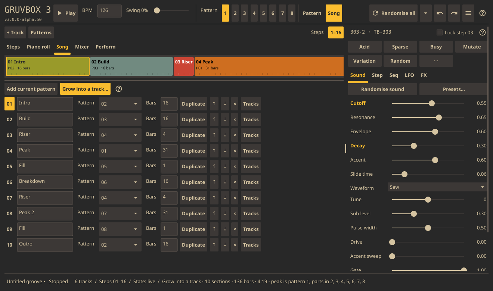
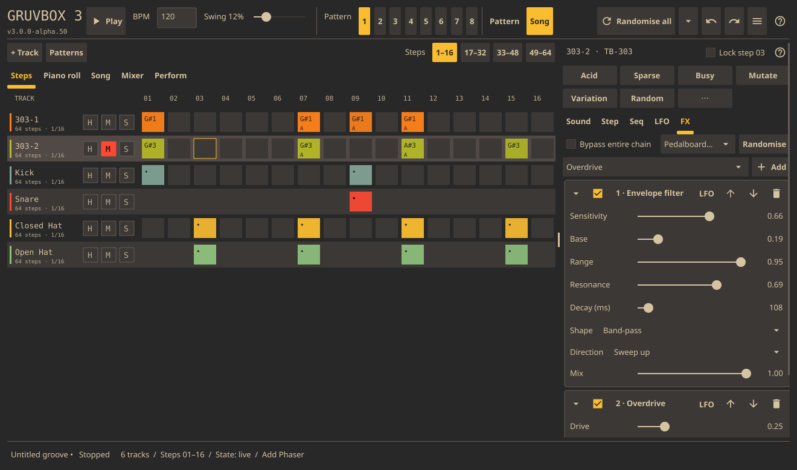
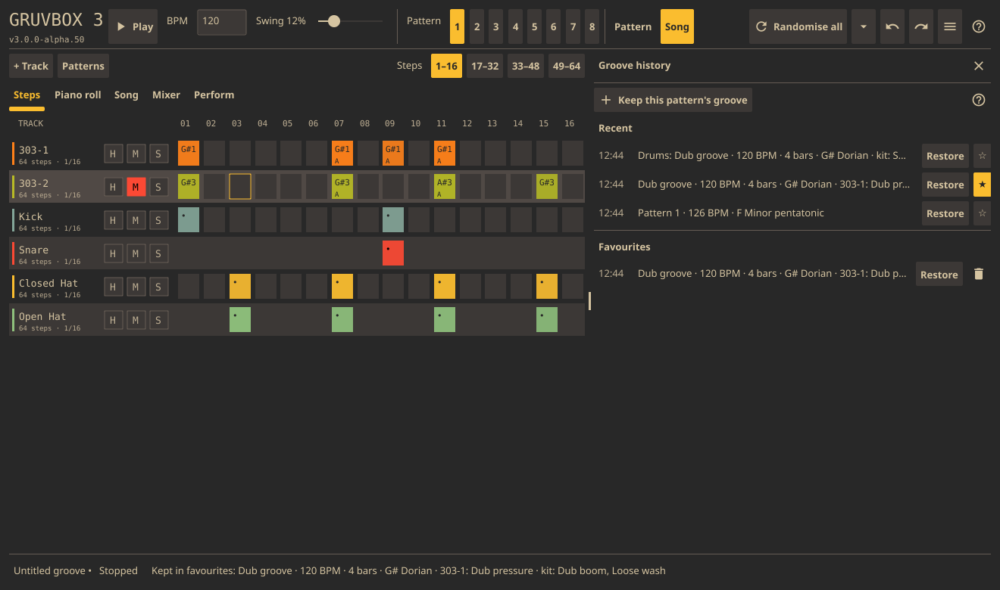
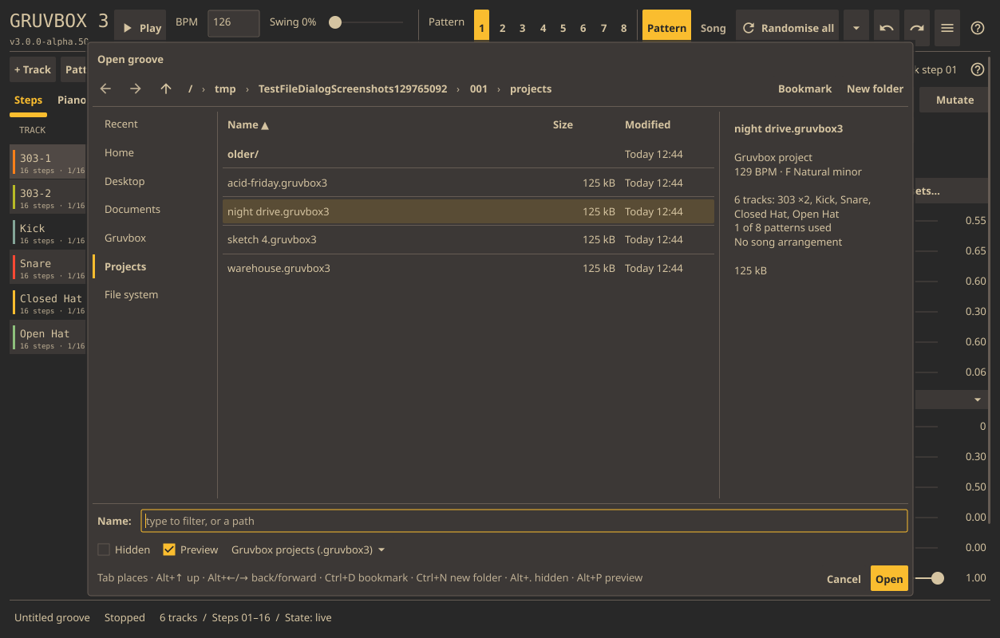

# Gruvbox

Version: 3.0.0-alpha.62

**A groovebox that starts with a good groove, and keeps it moving.**



Press **Play** the moment it opens and you are already listening to something
worth keeping. Each launch writes a fresh groove in one of six styles (acid,
minimal, electro, dub, hypnotic or broken): in key, with a matching kit,
sounds and effects. Hold the parts you like and re-roll the rest. **Grow into
a track** turns the loop into a full arrangement in a few seconds. Switch on
**Jam** and it keeps evolving while you listen. When it lands on something
good, keep it and export it to WAV.

| | |
|---|---|
|  |  |
| **Grow into a track:** one loop becomes a whole song. | **Effects:** per-track pedal chains, each pedal with its own LFO. |
|  |  |
| **Groove history:** go back to anything you heard; star the keepers. | **Files:** a keyboard-driven Open/Save dialog with previews. |

It is a native Linux desktop app, still in alpha. If you enjoy it, you can
[support Gruvbox on Ko-fi](https://ko-fi.com/subbaan). ♥

## Listen

These loops come straight out of Gruvbox: random grooves exported with
**Export WAV**, with no editing.

| Loop | Length |
|---|---|
| [▶ Sub Zero](docs/audio/sub-zero.mp3) | 0:08 |
| [▶ Phrygian Meltdown](docs/audio/phrygian-meltdown.mp3) (132 BPM, G Phrygian) | 0:08 |
| [▶ Velvet Undertow](docs/audio/velvet-undertow.mp3) (115 BPM, B minor, swung) | 0:08 |
| [▶ Abyssal Drift](docs/audio/abyssal-drift.mp3) | 0:08 |
| [▶ Easy Voltage](docs/audio/easy-voltage.mp3) | 0:04 |
| [▶ Ghost Signal](docs/audio/ghost-signal.mp3) | 0:07 |

## Getting it

Pre-built Linux x86-64 binaries are attached to the
[releases](https://github.com/subbaan/gruvbox/releases). Download
`gruvbox-linux-x86_64`, make it executable (`chmod +x`) and run it.

To build it yourself you need Go 1.24 or newer, a C compiler, and the
OpenGL, X11 and ALSA development files:
- Arch: `mesa libx11 libxcursor libxrandr libxinerama libxi libxxf86vm alsa-lib`
- Debian or Ubuntu: `libgl1-mesa-dev xorg-dev libasound2-dev`

```bash
git clone https://github.com/subbaan/gruvbox.git
cd gruvbox
go build -trimpath -o gruvbox
./gruvbox
```

## Running

```bash
./gruvbox                  # the desktop app
./gruvbox --no-audio       # edit without opening an audio device
./gruvbox --version        # or -V
./gruvbox --help           # every option
./gruvbox --tui            # the legacy terminal interface (see docs/TUI.md)
```

Projects, sounds, themes and settings live in `~/Documents/gruvbox`.

## Quick start

1. **Space** plays the groove Gruvbox started with. The status line names its
   style, tempo, key and the sounds it picked.
2. **Ctrl+R** (**Randomise all**) gives you a fresh groove in the same
   pattern. Like a part? Press **H** to hold that track, and randomising
   leaves it alone. The **▾** beside Randomise all re-rolls only the drums or
   only the 303s.
3. Select a track and press **G** (**Fit groove**) for a new part that suits
   the groove, or **R** for a new sound. The buttons at the top of the
   inspector hold more generators.
4. **+ Track** adds an instrument, set up the way the groove's style would
   use it. Press **G** to give it a part.
5. **Ctrl+G** grows the pattern into a whole song, and **J** starts Jam.
6. **Ctrl+H** opens groove history if you want an earlier groove back.
7. **≡ → Export WAV** writes the pattern or the song. **Ctrl+S** saves.

Every change can be undone (**Ctrl+Z**). The **?** buttons explain what is
around them, and the one in the top bar lists every shortcut.

## Instruments

- **TB-303** acid voices with a diode-ladder filter, accent and slide. Beyond
  the classic knobs there are drive, an accent sweep that builds over
  consecutive accents, gate length, pulse width, a saw/square mix, noise and
  band-pass and high-pass filter modes. 32 built-in sounds.
- **Dual synth**: two oscillators (saw, pulse, triangle or sine) into a
  driven 12/24 dB filter with separate filter and amp envelopes. What two
  oscillators can do is its strength: an interval on oscillator 2 makes every
  note a two-note chord, **sync** gives the tearing sync lead (sweep it with
  the envelope or an LFO), **FM** makes bells and knocking basses, **ring
  mod** makes metallic tones, and **unison** thickens oscillator 1 into three
  detuned voices. In grooves it plays held, sliding melodies, offbeat chord
  stabs, pads, counter lines and layers. 15 built-in sounds.
- **SH-101**, modelled on the Roland original: one oscillator mixing saw,
  pulse, a locked sub-oscillator and noise into a self-oscillating 24 dB
  filter, with one envelope, its own LFO (which can retrigger the envelope
  for trills) and portamento. In grooves it plays what its arpeggiator and
  sequencer were known for: **Arp** runs up and down each bar's chord, and
  **Sequence** loops a short figure that cycles across the bar line. 11
  built-in sounds.
- **Drums**: analog-modelled kick, snare, clap, rimshot, closed and open hat,
  tom and crash, each with five to eight built-in sounds. Toms can play
  pitched notes, down to a bassline.
- **Sampler**: load a WAV (or record one from an input or the system output),
  trim it, play it pitched, reversed, one-shot, gated or looped.

Every synth and drum track has two LFOs. **Randomise sound** (**R**) usually
starts from one of the track's built-in sounds and varies it, so settings
that belong together stay together. **Sound → Presets…** opens the sound
library: try the built-in sounds, save your own, and import or export
`.gruvsound` files.

## Effects

Every track has its own chain of effects: overdrive, fuzz, distortion,
envelope filter (auto-wah), multimode filter, phaser, flanger, chorus, tape
echo, delay, reverb, bit crusher and compressor. Each effect has two LFOs of
its own. **FX → Pedalboard…** loads a ready-made chain whose settings vary
each time within the board's idea (Squelch wah, Fuzz acid, Dub tape and
more), and **FX → Randomise** explores the chain you have. Playback and export
go through a master limiter, so loud grooves don't clip.

## Making grooves

- **Styles**: a new groove's style picks the tempo, swing, key, length (one,
  two or four bars), track layout, drum patterns, sounds and effects. It also
  leaves one or two tracks silent with a sound ready, for you or Jam to bring
  in.
- **Fit groove** (**G**) writes a part that suits the groove: the style's
  drum pattern, or for a synth a line in its role (bass, counter line, pad,
  stabs, melody, arpeggio…) in the groove's key. Parts above the bass stay an
  octave clear of it and play in its gaps.
- **Generators** at the top of the inspector write other kinds of part:
  Acid, Bassline, Sparse and Busy lines in key; Lead and Stabs on the Dual;
  Arp and Sequence on the SH-101; drum families such as four-on-the-floor,
  broken, half-time and shuffled hats; Mutate and Variation. Under **⋯** are
  a phrase composer, Euclidean rhythms and a parameter-lock generator
  (sweeps, ladders, build-ups, humanise).
- **Groove history** (**Ctrl+H**) keeps the last 20 grooves you randomised.
  Star favourites to keep them between runs.

## Editing

- **Steps and piano roll**: click to enter notes; drag a note's right edge to
  lengthen it; shift-click to select several and drag them as a phrase. Each
  step has velocity, probability, accent, slide and "every N loops".
- **Parameter locks**: press **K** (Lock step) and any sound or effect control
  you move is written for the selected step only. Steps with locks show **L**.
- **Patterns**: 64 slots, A1 to H8, in eight banks. Pattern changes while
  playing land on the next bar. **Ctrl+Shift+P** stores a pattern's whole
  sound and mix, so switching patterns can change the sound too.
- **Mixer** tab: level, pan, mute and solo for every track side by side.

## Arranging and performing

- **Song** tab: sections of patterns with bar counts and per-section mutes,
  shown as a timeline. Choose **Song** beside the pattern pads to play it.
- **Grow into a track** (**Ctrl+G**): the selected pattern becomes the peak,
  and the rest of its bank gets an intro, build, riser, fills, breakdown and a
  second peak made from it, laid out as a song. **Short** is about two
  minutes at 128 BPM, **Full** about four.
- **Jam** (**J**, Perform tab): every 4, 8 or 16 bars it makes a change, from
  **Gentle** (a nudge) to **Wild** (new lines and patterns). In between it
  builds up and breaks down: parts come in and filters open, then parts drop
  out and it gets wetter. Each change can be undone, and held tracks are left
  alone.
- **Perform** tab: queue a drum fill (**F**) or a variation for the next bar;
  keep the last take in an empty pattern.

## Exporting

**≡ → Export WAV** writes the selected pattern or the whole song as a 16-bit
44.1 kHz stereo WAV. A pattern export loops seamlessly by default: the
effect tails from the previous pass are already sounding at the start. A song
export adds the tails at the end. Right-click a track name and choose
**Render this track to WAV** to export one track on its own.

## Files and themes

Projects are `.gruvbox3` files with samples embedded. A new groove is named
after its style, key and tempo. All file choices use one dialog with places,
bookmarks, recent files, previews and keyboard navigation (Tab, Alt+↑,
Ctrl+D to bookmark).

**≡ → Appearance…** switches between Base16 colour themes with a live preview,
imports YAML themes and downloads them from the
[Tinted Theming](https://github.com/tinted-theming/schemes) collection. The
same is available on the command line: `--theme-list`, `--theme <id>`,
`--theme-import <file>`, `--theme-download <name>`.

## Keyboard shortcuts

| Keys | Action |
|---|---|
| Space | Play / stop |
| 1–8, Alt+1–8 | Pattern in the bank shown; show bank A–H |
| ← → ↑ ↓ | Move between steps and tracks |
| Enter, Delete | Toggle step, clear step |
| A, L, `,` `.` | Accent, slide, velocity down / up |
| [ ] | Previous / next 16-step page |
| G, R | Fit groove, randomise sound |
| H, M, S | Hold, mute, solo the track |
| K | Lock mode: controls write step locks |
| Ctrl+R | Randomise all (Ctrl+Shift+R drums only, Ctrl+Alt+R 303s only) |
| Ctrl+G, J, Ctrl+H | Grow into a track, Jam, groove history |
| F | Queue a drum fill (while playing) |
| Ctrl+C / Ctrl+V | Copy / paste a step (Ctrl+Shift for the whole pattern) |
| Ctrl+D | Duplicate the groove to an empty slot |
| Ctrl+Shift+P | Store the pattern's state |
| Ctrl+Z, Ctrl+Shift+Z or Ctrl+Y | Undo, redo |
| Ctrl+Tab | Next editor tab |
| Esc | Close a drawer or card, then leave lock mode |
| Ctrl+N, Ctrl+S, Ctrl+Shift+S | New groove, save, save as |

## What's new

See [CHANGELOG.md](CHANGELOG.md). In 3.0.0-alpha.62 the Dual synth gained
sync, FM, ring mod and unison with nine new sounds. The Dual and the SH-101
also now write different parts in a groove: Lead and Stabs on the Dual,
Arp and Sequence on the SH-101.

## Support

If Gruvbox gives you a groove worth keeping, you can buy me a coffee at
[ko-fi.com/subbaan](https://ko-fi.com/subbaan). The link is also in the app,
under **≡ ▸ Support on Ko-fi…** and **≡ ▸ About Gruvbox…**.

## Development

How the code is laid out, the real-time audio rules, testing and releasing
are in [docs/DEVELOPMENT.md](docs/DEVELOPMENT.md).

## Licence

MIT. See [LICENSE](LICENSE).
